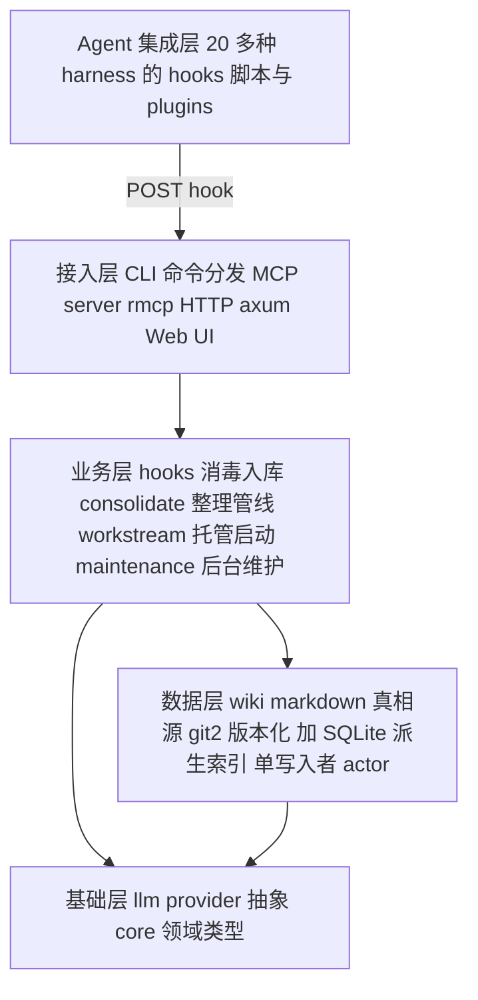
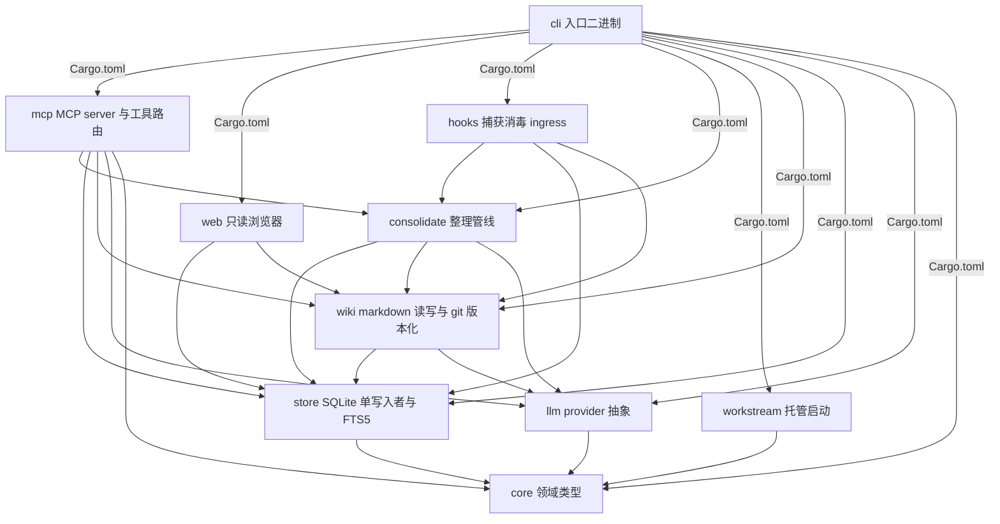
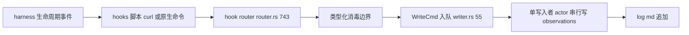

# 架构地图：ai-memory

> 仓库：https://github.com/akitaonrails/ai-memory | 分支：master | 提交：f803819e5b01e033f92341c58c27f9606d58ed09 | 分析日期：2026-11-05
> 分析方式：本地 clone（learning/ai-memory/repo），全部结论基于源码与各 crate Cargo.toml，非上游文档转述。

## 总体架构

单二进制（`ai-memory`）= CLI 命令分发器 + MCP/HTTP 服务器 + 后台维护 worker。五层结构：



| 层 | 成员 | 职责 |
|---|---|---|
| Agent 集成层 | `hooks/`（15+ agent 目录）、`plugins/`、`companions/` | 各 harness 的 lifecycle hook 脚本，把事件 `curl POST /hook` 或走原生 `ai-memory hook` 命令 spool |
| 接入层 | cli crate + mcp crate + web crate | 命令分发（lib.rs `run()`）、MCP 工具路由（rmcp）、HTTP 路由（axum）、只读浏览器 UI |
| 业务层 | hooks crate（ingress+消毒）、consolidate crate（整理/查询/lint 管线）、workstream crate（托管启动）、maintenance tick | 业务规则全部在这层 |
| 数据层 | wiki crate + store crate | markdown 真相源（git2 每次整理/会话结束出 commit）+ SQLite 派生索引（单写入者 actor，WAL，读池上限 4） |
| 基础层 | core crate + llm crate | 领域类型与错误；LLM provider trait（Anthropic/OpenAI/Gemini/Copilot/Cursor/OpenAI-compat + candle 本地嵌入） |

核心不变量（ARCHITECTURE.md 声明 + 源码印证）：**markdown wiki 是真相源，SQLite 是可重建的派生索引；所有外部文本经过 hooks crate 的类型化消毒边界才能入库；写路径串行化于单写入者 actor。**

## 模块依赖关系

依赖方向来自各 crate `Cargo.toml [dependencies]`（每条边 VERIFIED）：



分层读法：`core` 是零依赖地基 → `llm`/`store` 只依赖 core → `wiki` 复用 store 与 llm → `consolidate` 编排 store+wiki+llm → `mcp`/`web`/`hooks` 是三种接入面 → `cli` 全量组装。**注意反向关系：hooks（捕获端）依赖 consolidate，是因为 SessionStart 的 brief/恢复快照渲染复用了整理层的摘录逻辑（hooks/src/brief_tiers.rs）。**

## 核心执行流程

### 流程一：hook 捕获（最高频路径，每工具调用一次）

文字调用链（每跳附源码位置）：

1. agent harness 触发 lifecycle 事件 → `hooks/<agent>/` shell 脚本（如 `hooks/claude-code/`）
2. `curl POST /hook` 或原生 `ai-memory hook --event ...`（本地 spool + `hook_drain_process.rs` 延迟投递，agent 热路径不阻塞网络）
3. → axum 路由 `hook_router(state)` `crates/ai-memory-hooks/src/router.rs:743`
4. → 消毒（hooks crate 的 sanitizer，唯一从不可信文本入存储的路径）→ `ObservationKind` 归一化（session-start/user-prompt/post-tool-use/session-end 等 10 种闭集）
5. → 入队 `WriteCmd`（`crates/ai-memory-store/src/writer.rs:55`，pub(crate)）→ `WriterHandle`（`writer.rs:915`）单写入者 actor 串行落库
6. → `observations` 表 + `observations_fts` + `log.md` 追加一行



### 流程二：session-end 整理（记忆从日志变成页的时刻）

1. `SessionEnd` 事件到达 → 服务端（`crates/ai-memory-mcp/src/server.rs`；会话结束状态机 `SessionEndDisposition` 定义于 `crates/ai-memory-store/src/lib.rs:112` 导出）
2. → 规则合成 `sessions/<id>.md` 摘要页（无 LLM）+ 打开一条 `Handoff` 行——同一 SQLite 事务内完成，防半态
3. → 可选 LLM 路径：`consolidate_session`（`crates/ai-memory-consolidate/src/consolidator.rs:264`）/ 多页批量 `consolidate_session_multi`（:774）改写成 `concepts/ decisions/ gotchas/` 页
4. → wiki crate 写文件 → git2 自动 commit（真相源落盘）

### 流程三：检索（memory_query）

FTS5 + 实体匹配 + 链接邻居 RRF 融合 → 可选向量 RRF（candle 本地嵌入 all-MiniLM-L6-v2）→ CJK unigram/bigram FTS 流（无空格中日韩搜索）→ 观察证据流（session 的捕获轮次投票给自己的 session 页）→ 权威乘数（kind/tier/pinned/tags）→ 可选 LLM reranker。命中页 bump `access_count`（衰减强化，每页每分钟最多一次）。

### 流程四：`ai-memory run` 托管启动（workstream crate）

解析 lease（租约）→ 选 harness → 注入启动 packet（workstream 简报 + handoff）→ 子进程退出后导入原生 transcript 尾部 + git checkpoint。租约恢复有 `--force-unlock` 与 `/recover/finish` 两条显式路径。

## 关键数据流

一条观察的一生：

```text
harness 事件 JSON
  → hooks 脚本（<16KiB 截断，agent 热路径非阻塞）
  → router.rs 消毒（不可信文本唯一入口）→ ObservationKind
  → WriteCmd 队列 → 单写入者 actor → observations 表（审计轨迹）
  → SessionEnd：规则合成 sessions/<id>.md + handoffs 行（单事务）
  → consolidate（可选 LLM）→ concepts/ 等主题页
  → wiki/<路径>.md 文件 + git commit（真相源）
  → store 全文/实体/链接索引同步更新（派生，可 reindex 重建）
```

关键取舍：**SQLite 全部可从 wiki/ 目录重建**（`ai-memory reindex`）；页面删除是 supersede-not-delete（版本链 + `restore-page` 可恢复）。

## 动态行为说明（静态分析受限处）

| 机制 | 位置 | 说明 |
|---|---|---|
| writer actor | `store/src/writer.rs` | 消息传递（WriteCmd）而非函数调用，调用链在 actor 边界断开；915 行 WriterHandle 是克隆句柄 |
| rmcp 工具路由 | `mcp/src/server.rs` | MCP 工具经 rmcp 宏注册，运行时分发；静态看是 trait 实现集合 |
| maintenance scheduler | 服务端后台 worker | 定时 tick（forget sweep / auto-improve / idle-end），非请求驱动，ARCHITECTURE.md 声明"ticks 非重叠" |
| wiki file watcher | `wiki` crate（notify 依赖） | 外部编辑（Obsidian/vim）被 watcher 感知并对账——运行时行为，静态只能看到 watcher 注册 |
| hook 快速路径 | `cli/src/lib.rs:34 run()` | Hook/HookDrain/Completions 在 Config 加载前短路 return——分发不是统一入口 |

## Git 历史（轻量）

- 初始提交 2026-05-21：`M0: bootstrap workspace, CI, config loader, and init command`，次日 M1-A 已落 "single-writer SQLite actor"——**单写入者是最早的设计决策之一**（M0→M1 里程碑命名对应 docs/design-decisions.md 的 v1 spec）
- 至 2026-11-05 共 5531 commits，发布节奏约每 1-2 天一个 patch（v3.3.1→v3.4.1 一周内），近期大动作：rmcp 2.2→3.8 升级（#1924）
- 启发来源（README 致谢）：Karpathy LLM Wiki（compile-not-retrieve）、agentmemory（hook 捕获）、basic-memory（markdown 真相源）、A-MEM（原子笔记）

## 证据清单

| 架构结论 | 证据 | 等级 |
|---|---|---|
| cli 是唯一二进制入口，薄 main + lib 分发 | `cli/src/main.rs`（shim 注释）、`cli/Cargo.toml [[bin]]` | VERIFIED |
| 命令分发与 hook 快速路径 | `cli/src/lib.rs:34 pub async fn run()` + match 分发 | VERIFIED |
| serve 挂载 mcp 路由 | `cli/src/commands/serve.rs:23-24,761`（use ai_memory_mcp、identity::router） | VERIFIED |
| hook ingress 路由 | `hooks/src/router.rs:743 pub fn hook_router`、`hooks/src/lib.rs` 头注释 POST /hook/batch | VERIFIED |
| 单写入者 actor | `store/src/writer.rs:55 WriteCmd`、`:915 WriterHandle`；store crate description "single-writer actor" | VERIFIED |
| session-end 整理入口 | `consolidate/src/consolidator.rs:264 consolidate_session`、`:774 multi`；`store/src/lib.rs:112 SessionEndDisposition` | VERIFIED |
| crate 间依赖方向 | 各 `crates/*/Cargo.toml [dependencies]`（本地 grep 全量提取） | VERIFIED |
| wiki 真相源 + SQLite 派生 | `wiki` crate description（"file watcher and git versioning"）+ ARCHITECTURE.md Storage 一节 | VERIFIED（声明）/ INFERRED（watcher 运行时行为） |
| 检索 RRF 各流 | docs/ARCHITECTURE.md Data flow 第 6 步（源码级 RRF 实现未逐行读） | INFERRED |
| 衰减/ forget sweep 细节 | docs/ARCHITECTURE.md 第 7 步（对应 store/maintenance 源码未逐行读） | INFERRED |
