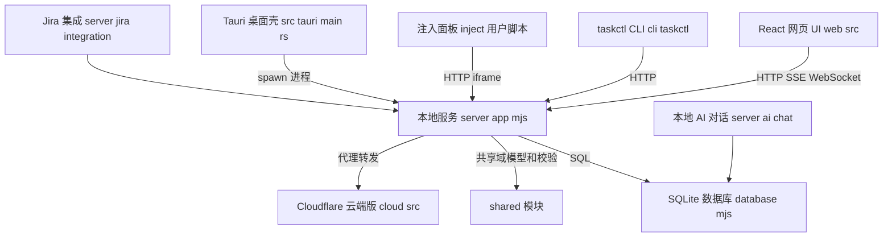
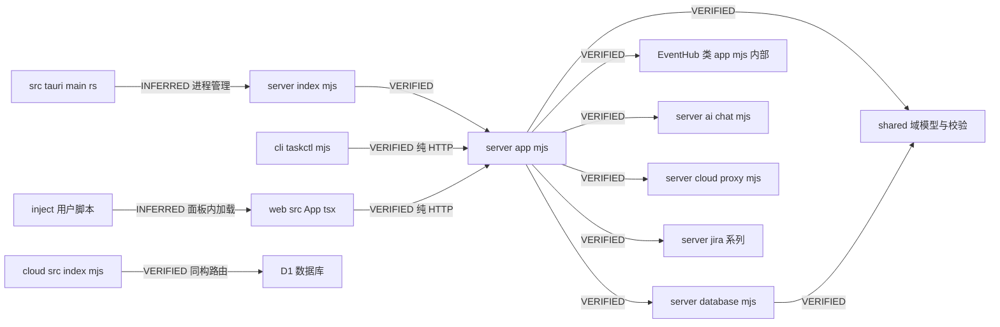
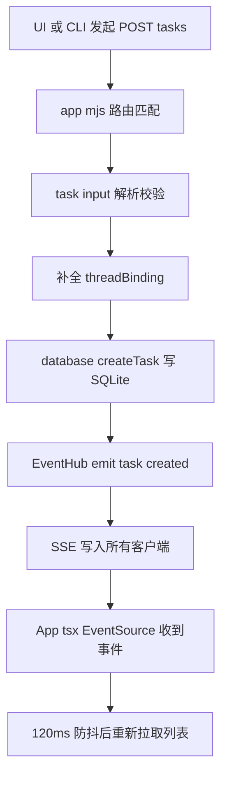
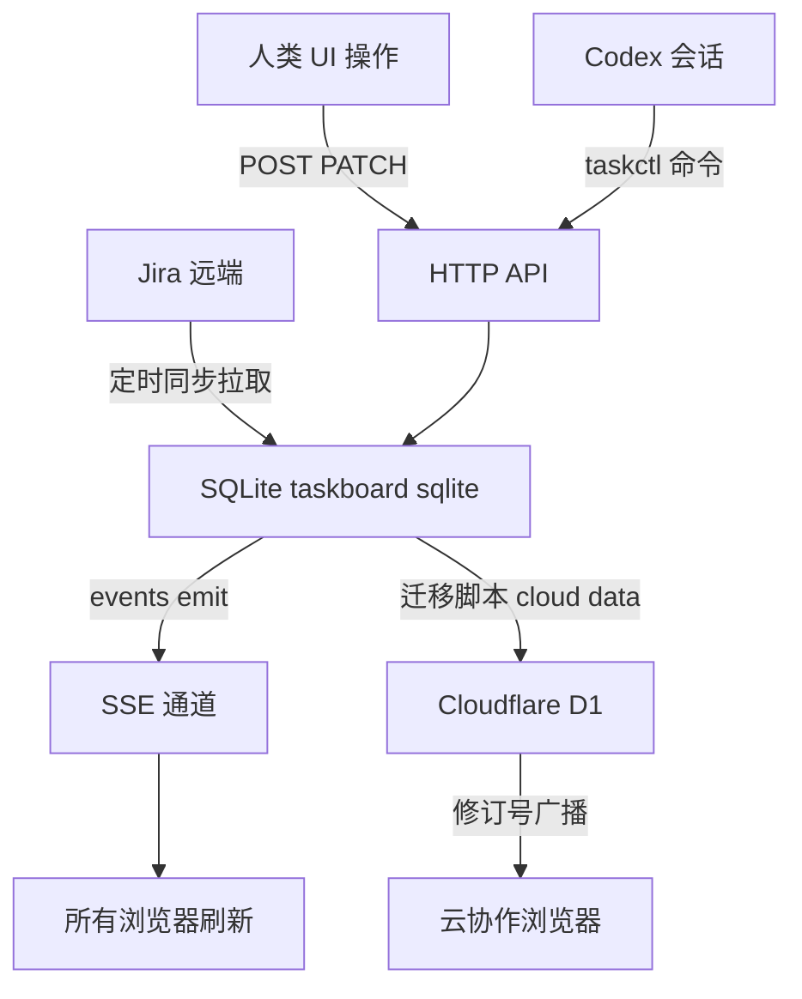

# 架构地图：Codex Taskboard (dashi-taskboard)

> 仓库：https://github.com/chuspeeism/dashi-taskboard | 分支：main | 提交：bdf7698f6c3f3737a65377814dbb9db7ce81ea38 | 分析日期：2026-10-23

## 总体架构

这是一个**单进程本地服务 + 多客户端**架构。核心是一个用原生 `node:http` 写的无框架 HTTP 服务（server/app.mjs），数据落在内置 `node:sqlite`（server/database.mjs）。三类客户端消费同一个 API：React 网页、`taskctl` CLI（AI 用）、注入到 Codex 里的 iframe 面板。桌面 App（Tauri）和云版（Cloudflare Worker）是同一业务模型的两种"外壳"。

类比理解：把 server/app.mjs 想象成一个"前台接待员"（所有请求都由一个大 if 链逐条匹配 pathname），database.mjs 是"档案室"（唯一写 SQL 的地方），shared/ 是"术语表"（前后端对同一份域模型的共同认知），EventHub 是"广播喇叭"（谁改了数据，全屋都知道）。

### 四个部署形态共享一套业务内核

| 形态 | 入口 | 存储 | 证据 |
| --- | --- | --- | --- |
| 本地服务 | server/index.mjs | SQLite (.data/taskboard.sqlite) | README + database.mjs VERIFIED |
| 桌面 App | src-tauri/src/main.rs 启动打包的 Node 服务 | App 数据目录 | main.rs + README VERIFIED |
| 云版 | cloud/src/index.mjs (Worker) | D1 + R2 | cloud/migrations + wrangler.jsonc VERIFIED |
| 本地 companion | server/app.mjs cloud-proxy 路由 | 本地映射 + 代理到云 | app.mjs cloud-config 导入 VERIFIED |

## 模块依赖关系

说明：
- CLI 和前端与服务器之间**没有代码级依赖**，只依赖 HTTP API 契约（cli/taskctl.mjs:856 拼接 `/api/tasks`，web/src/api.ts 类型定义 VERIFIED）。
- shared/ 是唯一被服务器直接 import 的跨端代码；前端通过手写类型（web/src/types.ts）镜像同一契约，属于约定同步而非编译期共享（INFERRED，基于 api.ts 的类型列表与 shared/task-input.mjs 字段一一对应）。
- src-tauri/main.rs 与 Node 服务是**进程级**关系（打包 Node runtime 后 spawn），非代码导入（INFERRED，依据 README 打包描述与 main.rs 中的进程/端口代码痕迹）。

## 核心执行流程一：创建任务并实时广播

文字调用链（每跳有源码位置）：

1. 用户在 UI 或 AI 通过 CLI 发起：
   - UI：`web/src/api.ts` 的请求函数 → `POST /api/tasks`
   - CLI：`cli/taskctl.mjs:868` `api.request("POST", "/api/tasks", ...)`（issue create 命令 → execute() → sendRequest() 第 526 行）
2. `server/app.mjs:2477` 路由命中 `pathname === "/api/tasks"` 且 `method === "POST"`
3. `app.mjs:2483-2485`：`actorFromRequest` 解析操作者 → `parseTaskCreate`（shared/task-input.mjs）校验输入 → `resolveInputThreadBinding` 补全 Codex 会话绑定五元组
4. `app.mjs:2494` `database.createTask(...)`（database.mjs 写 SQLite，含版本号 version 递增）
5. `app.mjs:2498` `events.emit("task.created", { task })`
6. `EventHub.emit`（app.mjs:1129-1138）：组装 SSE 消息，遍历 `this.clients`（Set，app.mjs:1102 connect 时加入，request close 时移除）逐个 `response.write()`
7. 前端 `web/src/App.tsx:602` `new EventSource(eventsUrl)` 常驻监听 → `handleEvent`（App.tsx:632）→ `scheduleRefresh` 120ms 防抖 → `refreshTasks` 重新拉取列表

关键设计点：**事件只当"脏标记"用，不当数据通道用**。SSE 消息带 projectId/taskId，但前端收到后并不增量合并，而是防抖后整体 refetch（App.tsx:608-630 VERIFIED）。这让前端不需要维护复杂的增量状态机——简单换正确性，小团队规模下完全够用。

## 核心执行流程二：AI 认领 issue（乐观并发）

skills/manage-taskboard/SKILL.md 规定的标准流程，体现整个产品的并发控制模型：

1. AI 运行 `taskctl issue get ID --json` → 拿到 issue 和当前 `version`
2. `taskctl issue move ID in_progress --if-version N`（cli/taskctl.mjs:913 moveIssue）
3. 服务器校验 `--if-version` 与数据库中的 version 是否一致（parseVersionMutation，shared/task-input.mjs；database.mjs 写入时校验）——不一致返回冲突错误
4. AI 收到冲突 → 重新 `issue get` → 按 SKILL.md 的严格规则决定是否用最新 version 重试一次

这是典型的**乐观锁**：不用长事务锁数据库，用单调递增 version 让所有写入方（多个 AI 会话 + 多个人类浏览器）自行协调。SKILL.md 甚至把"冲突后怎么重试、什么时候必须停手"写成了 AI 行为规范，这是把并发协议上升到产品层。

## 关键数据流

**数据的产生、流转与归宿**：

- 人类与 AI 都通过同一个 HTTP API 写入（VERIFIED）
- Jira 是唯一的外部数据源，`GET /api/tasks` 时若项目为 jira-my-tasks 会触发 `jira.sync()`（app.mjs:2480 VERIFIED），同步到本地库
- 本地 → 云是单向一次性迁移（scripts/migrate-to-cloud.mjs，README："Cloud mode never falls back to or double-writes the local SQLite database" VERIFIED 引自 README）
- 附件：本地存文件系统（database.mjs createProjectReadmeAttachment 等），云端存 R2 私有桶（README VERIFIED）

## 动态行为说明（静态分析的边界）

| 动态机制 | 位置 | 静态分析的局限 |
| --- | --- | --- |
| SSE 事件分发 | app.mjs EventHub.emit | 事件类型是字符串（task.created 等），emit 点与前端 handler 靠字符串约定对齐，编译器无法检查，需靠 e2e 测试保证 |
| Codex CDP 注入 | scripts/codex-injector.mjs | 运行时通过 CDP 向 Codex Electron 渲染进程注入脚本，注入后的行为（侧边栏挂载、iframe 加载）在 Codex 进程内，本仓库源码无法完全覆盖，只能读到注入器侧的协议 |
| threadBinding 五元组 | shared/task-records.mjs + app.mjs resolveInputThreadBinding | 绑定的"真值"来自运行时的环境变量（CODEX_THREAD_ID 等），静态代码只见校验逻辑 |
| Tauri ↔ Node 进程协作 | src-tauri/src/main.rs | Rust 通过端口探测/进程启动与 Node 服务协作，时序行为需运行时验证 |
| 云版修订号广播 | cloud/src/index.mjs | D1 全局 revision 变化 → 客户端刷新，具体触发频率依赖 Worker 运行时 |

## 证据清单

| 架构结论 | 证据 | 等级 |
| --- | --- | --- |
| HTTP 服务无框架，用 node:http 大 if 链分发 | app.mjs:27 `import { createServer } from "node:http"`；app.mjs:1812-2520 路由链 | VERIFIED |
| 数据层单点：TaskboardDatabase + node:sqlite | database.mjs:19,261 | VERIFIED |
| SSE 实时广播 + 前端防抖 refetch | app.mjs:1100-1140 EventHub；App.tsx:602-630 | VERIFIED |
| CLI 通过 HTTP API 消费，与服务器无代码依赖 | cli/taskctl.mjs:526,856,868,913 | VERIFIED |
| 乐观并发（version + if-version） | SKILL.md 工作流第 2/3 条；task-input.mjs parseVersionMutation | VERIFIED |
| Jira 在列表读取时同步 | app.mjs:2480 `if (!filters.projectId \|\| filters.projectId === JIRA_PROJECT_ID) await jira.sync()` | VERIFIED |
| 桌面 App 打包自带 Node runtime 并启动服务 | README 桌面章节 + main.rs 进程管理代码 | VERIFIED（README）/ INFERRED（具体时序） |
| 前端类型与 shared 契约手工镜像 | web/src/api.ts 类型导入列表 vs shared/task-input.mjs | INFERRED |
| 注入后的 Codex 内部行为 | 仅注入器侧源码 | UNKNOWN（Codex 闭源部分） |
