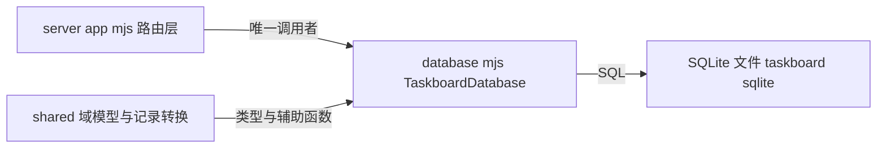

# 模块学习：数据层（shared 域模型 + server/database.mjs）

> 仓库：https://github.com/chuspeeism/dashi-taskboard | 分支：main | 提交：bdf7698 | 分析日期：2026-10-23

## 1 问题：这个模块解决什么问题

多客户端（人 + 多个 AI 会话）同时对同一批 issue 做读写，如何保证：
- 数据不写坏（校验 + 事务）；
- 并发修改可被检测而不是互相覆盖（乐观锁 version）；
- 排序可以拖拽微调而不重排全表（稀疏 sort_order）；
- issue 编号稳定可读（`PREFIX-N`）且删了中间的也不会重号。

一句话：**它是整个产品唯一"说真话"的地方**——所有状态约定（什么算合法状态、什么算冲突）都收敛在这一层，上层（app.mjs、CLI、前端）只是传话筒。

## 2 职责：它负责什么，不负责什么

**负责**（VERIFIED）：
- 全部 SQLite 表结构和幂等迁移（database.mjs `#migrate()`）
- 全部 SQL 读写 + 事务边界（`BEGIN IMMEDIATE` / `COMMIT` / `ROLLBACK`）
- 乐观版本校验（`#requireVersion` + `WHERE version = ?` 原子守卫）
- 行 → API 形状的转换（`taskFromRow`，snake_case → camelCase）
- 活动记录（task_activities，Linear 风格变更流水）

**不负责**：
- HTTP 协议、鉴权、SSE 广播——那是 app.mjs 的事（database.mjs 无 import ws/http，VERIFIED）
- 输入的"业务语义"解析（比如 `parseTaskCreate` 在 shared/task-input.mjs，数据库只收解析后的结构）
- 文件附件的二进制存储（attachments 表只存元数据：filename/content_type/size；内容走 app.mjs 的文件系统）

## 3 位置：它在整体架构中的角色



单实例、单进程持有。WAL 模式（database.mjs:263 `PRAGMA journal_mode = WAL`）允许读并发、写串行——配合 Node 单线程事件循环，"一个写事务一个锁"就够，不需要连接池。

## 4 接口：对外公开的 API

`TaskboardDatabase` 类的公开方法（grep 方法名验证，database.mjs）：

| 类别 | 方法 | 说明 |
| --- | --- | --- |
| 生命周期 | constructor / close() | 打开库 + 迁移；关闭 |
| 项目 | listProjects / createProject / getProject / deleteProject / addProjectLabel / deleteProjectLabel | 项目与标签 |
| 任务 | listTasks(filters) / getTask / createTask / updateTask / moveTask / archiveTask | 核心 CRUD + 移动 |
| 关系 | addTaskRelation / removeTaskRelation / getTaskTree（上限 1000 节点，TASK_TREE_MAX_NODES） | parent/blocks/related |
| 评论附件 | comment 系列 / attachment 系列 | 带 change_revision |
| README/摘要 | getProjectReadme / saveProjectReadme（带版本）/ saveProjectSummary | 项目文档 |
| AI 线程 | listAiChatThreads / createAiChatThread / updateAiChatThread / listAiChatRuns … | AI 对话持久化 |

约定：**每个"会改数据"的方法都接收 `version` 参数**并在方法内校验——乐观锁是接口契约的一部分，不是可选项。

## 5 数据：核心数据结构

### tasks 表（database.mjs:274-326，40+ 列，节选有教学价值的部分）

```sql
CREATE TABLE IF NOT EXISTS tasks (
  id TEXT PRIMARY KEY,                        -- randomUUID()
  identifier TEXT NOT NULL UNIQUE,            -- "LOCAL-1" 这种人类可读编号
  project_id TEXT NOT NULL REFERENCES projects(id),
  status TEXT NOT NULL CHECK (status IN (
    'backlog','todo','in_progress','in_review','blocked','done','canceled')),
  labels TEXT NOT NULL DEFAULT '[]',          -- JSON 数组存 TEXT
  sort_order REAL NOT NULL,                   -- 稀疏排序的关键：REAL + 间隔 1000
  thread_id TEXT,                             -- ↓ threadBinding 五列，绑定 Codex 会话
  thread_codex_project_id TEXT,
  thread_codex_project_kind TEXT,
  thread_codex_host_id TEXT,
  thread_workspace_path TEXT,
  git_branch TEXT, worktree_path TEXT, worktree_branch TEXT,  -- 开发上下文（三列互斥组合）
  archived_at TEXT,                           -- 软删除（归档）
  version INTEGER NOT NULL DEFAULT 1 CHECK (version > 0),     -- 乐观锁计数器
  created_at TEXT NOT NULL, updated_at TEXT NOT NULL
);
CREATE INDEX tasks_project_status_sort
  ON tasks(project_id, archived_at, status, sort_order, created_at);  -- 为看板查询定制
```

读表的三个设计信号：
1. **状态用 CHECK 约束写死在库里**——即使上层校验漏了，数据库也会拒绝非法状态。约束下沉到最可信的一层。
2. **labels 存 JSON 字符串**而不是关联表——SQLite 场景下查询需求简单（整包展示），不值得为它建 join 表。取舍：无法按标签走索引查询，但数据规模是个人看板，可接受（INFERRED，作者意图）。
3. **threadBinding 五列平铺**而不是一张绑定表——一对一关系平铺最简单；`storedThreadBinding` 辅助函数（shared/task-records.mjs）负责编码/解码。

### 两个"聪明的小结构"

- **稀疏 sort_order（REAL）**：新任务置顶 = `MIN(sort_order) - 1000`，置底 = `MAX + 1000`（createTask/moveTask 内 VERIFIED）。拖拽时只在两邻居之间取中值。典型的"gap 排序"技巧，避免拖一张卡片重写全列。
- **comment_attachment_revision（单例行）**：`id INTEGER PRIMARY KEY CHECK (id = 1)`——用一行存一个全局计数器，前端据此判断"评论附件列表变了没有"。用数据库约束保证永远只有一行。

### 行 → API：taskFromRow（database.mjs:64-115）

数据库是 snake_case，API 是 camelCase；`labels` JSON.parse；`developmentContext` 是**派生字段**——库里没有这列，由 `worktree_path ? worktree : (git_branch ? branch : null)` 三列组合推导。这是"存储归一化、表现归读者"的典型处理。

## 6 执行：内部执行流程

### 写路径（以 moveTask 为例，database.mjs:2053-2104）

```js
moveTask(id, version, status, sortOrder, ...) {
  const current = this.#requireTask(id);          // 1. 读当前行
  this.#requireVersion(current, version);          // 2. 预检版本（友好提前报错）
  // ... 计算 sortOrder 缺省值
  this.database.exec("BEGIN IMMEDIATE");           // 3. 立刻拿写锁
  try {
    const result = this.database.prepare(`
      UPDATE tasks SET status=?, sort_order=?,
        version = version + 1, updated_at=?
      WHERE id = ? AND version = ?                 // 4. 原子守卫
    `).run(...);
    if (result.changes !== 1) {                    // 5. 0 行受影响 → 丢了还是冲突？
      this.#throwMissingOrConflict(id, version);   //    重查一次区分 404 vs 409
    }
    this.#recordTaskActivity(...);                 // 6. 记活动流水
    this.database.exec("COMMIT");
  } catch (e) { this.database.exec("ROLLBACK"); throw e; }
  return this.getTask(current.id);                 // 7. 回读返回最新完整形状
}
```

这是**双层乐观锁**：
- 第 2 步 `#requireVersion`（database.mjs:2856）是"快失败"——版本明显过期就直接 409 `VERSION_CONFLICT`，不进事务；
- 第 4 步 `WHERE id = ? AND version = ?` 是"真保证"——预检和更新之间存在窗口（另一客户端可能刚好写入），只有这条原子 UPDATE 说了算。
- `BEGIN IMMEDIATE` 在第 3 步就抢写锁（而不是等到第一条写语句），保证"读 current → 写"之间不会插进别的写事务。

`#throwMissingOrConflict`（database.mjs:2874）值得注意：UPDATE 影响 0 行有两种原因（任务没了 / 版本冲突），它重新查一次来区分 404 和 409——**不吞歧义**。

### createTask 的编号生成（database.mjs:1808-1837）

```js
const maximum = ...SELECT MAX(CAST(substr(identifier, ?) AS INTEGER))
                FROM tasks WHERE identifier GLOB 'PREFIX-[0-9]*'...;
const number = Math.max(project.next_task_number, maximum + 1);
```

计数器 `next_task_number` 和实际最大编号**取大者**：即使有人手动删过编号最大的任务，也不会发出重复编号。整个"读计数器 → INSERT → 更新计数器"包在 `BEGIN IMMEDIATE` 事务里，消除 TOCTOU。

### 读路径 listTasks（database.mjs:1680-1723）

动态拼 WHERE → 一条主查询拿全部行 → 然后**批量**补关系、评论活动、预览图（`#taskRelationsForTasks(ids)` 一次 IN 查询）。避免逐行 N+1。排序在 SQL 里用 `CASE status WHEN 'backlog' THEN 1 ...` 按看板列顺序排——排序语义属于数据层，前端拿到的就是最终顺序。

### 迁移 #migrate()（database.mjs:268 起）

没有版本号迁移框架，而是**幂等收敛**：`CREATE TABLE IF NOT EXISTS` 打底 → `PRAGMA table_info` 查现有列 → 缺列就 `ALTER TABLE ADD COLUMN` → 旧结构清理（DROP `workflow_id` 列、`linked_thread_id` 数据搬进 `thread_id` 后删列，database.mjs:486-514 VERIFIED）。每次启动都跑，跑完就是目标状态。

## 7 源码：关键文件与函数

| 文件 | 符号 | 角色 | 证据 |
| --- | --- | --- | --- |
| shared/domain.mjs | TASK_STATUSES / TASK_PRIORITIES / isTaskStatus | 词汇表，前后端共享 | VERIFIED |
| server/database.mjs:261 | constructor + PRAGMA（WAL、busy_timeout 5000、foreign_keys ON） | 打开与调优 | VERIFIED |
| server/database.mjs:268 | #migrate() | 幂等迁移 | VERIFIED |
| server/database.mjs:64 | taskFromRow | 行→API 形状 | VERIFIED |
| server/database.mjs:1680 | listTasks | 动态过滤 + 批量装配 | VERIFIED |
| server/database.mjs:1808 | createTask | 事务内编号生成 + 插入 | VERIFIED |
| server/database.mjs:2053 | moveTask | 双层乐观锁范本 | VERIFIED |
| server/database.mjs:2856,2874 | #requireVersion / #throwMissingOrConflict | 409 语义 | VERIFIED |
| shared/task-records.mjs | storedThreadBinding / taskFieldChanges / attachTaskActivity | 绑定与活动序列化 | VERIFIED |

## 8 设计：作者为什么这样设计

1. **node:sqlite 而不是 better-sqlite3**：零依赖、Node 官方维护、API 同步。代价是生态更新（无加密、扩展少），对个人看板无所谓。
2. **CHECK 约束 + 上层校验双保险**：shared/task-input.mjs 管"报错好看"，CHECK 管"底线不破"。纵深防御，且各自成本极低。
3. **预检 + 原子守卫双层 409**：预检为了给 AI 客户端一个明确、可重试的错误（SKILL.md 第 3 条就依赖这个语义：冲突 → 重读 → 用最新 version 重试一次）；原子守卫为了正确性。
4. **version 计数器贯穿一切写操作**：把"谁先谁后"的问题从分布式协调降维成"数据库里的一个整数比较"。这是这个产品敢让多个 AI 会话同板操作的根基。
5. **归档不删除**（archived_at 软删）：Jira 同步会 `archiveMissing`（database.mjs:980 syncJiraTasks），AI 误操作可恢复，审计流水完整。

## 9 替代方案：其他可能的设计与取舍

| 决策点 | 本项目选择 | 被放弃的方案 | 取舍 |
| --- | --- | --- | --- |
| 数据库 | SQLite (WAL) | Postgres/MySQL | 单机零运维 vs 多写者扩展；LAN 多人共写一台机器时 SQLite 写吞吐足够 |
| 并发控制 | 乐观锁 version | 行锁/SELECT FOR UPDATE、事件溯源 | SQLite 单写者下锁意义有限；乐观锁错误信息可指导 AI 自动重试 |
| 迁移 | 幂等收敛（无版本号） | 编号迁移文件（如 flyway 风格） | 免去迁移顺序管理；代价是历史演进只存在于 git 历史，且无法表达"不可逆迁移" |
| 标签 | JSON TEXT 列 | 标签表 + 多对多 | 读简单；按标签过滤要全表 JSON 解析（当前规模可接受，数据涨了要改） |
| 排序 | REAL 稀疏间隔 | 链表/重排全表 | O(1) 拖拽；REAL 精度耗尽理论上要重整（间隔 1000 起步，极难触达） |
| 活动流水 | task_activities 表 | 只存 updated_at | Linear 式时间线是产品功能而非附属；写入成本低 |

## 10 练习：建议你实现什么

按 Implement 流（TypeScript + Node.js + vitest，映射规则见 implement-flow）：

**练习 A（核心，强烈推荐）：迷你乐观锁看板**
- 用 `node:sqlite`（或内存 Map + 事务模拟）实现 `createTask / moveTask / listTasks` 三个方法
- 必须复刻三层防线：CHECK 式状态校验、`#requireVersion` 预检、`WHERE version = ?` 原子守卫
- 测试用例必须包含：两个并发 move 用同一 version，恰好一个成功一个 409；删任务后再 create 不重号
- 跳过的部分：threadBinding、活动流水——掌握 version 语义后再加

**练习 B（排序专题）：稀疏 sort_order**
- 实现"置顶/置底/拖到两卡片之间"三种放置，断言其余行的 sort_order 不变

做完 A 即可宣称"独立复现了本模块的核心能力"。
