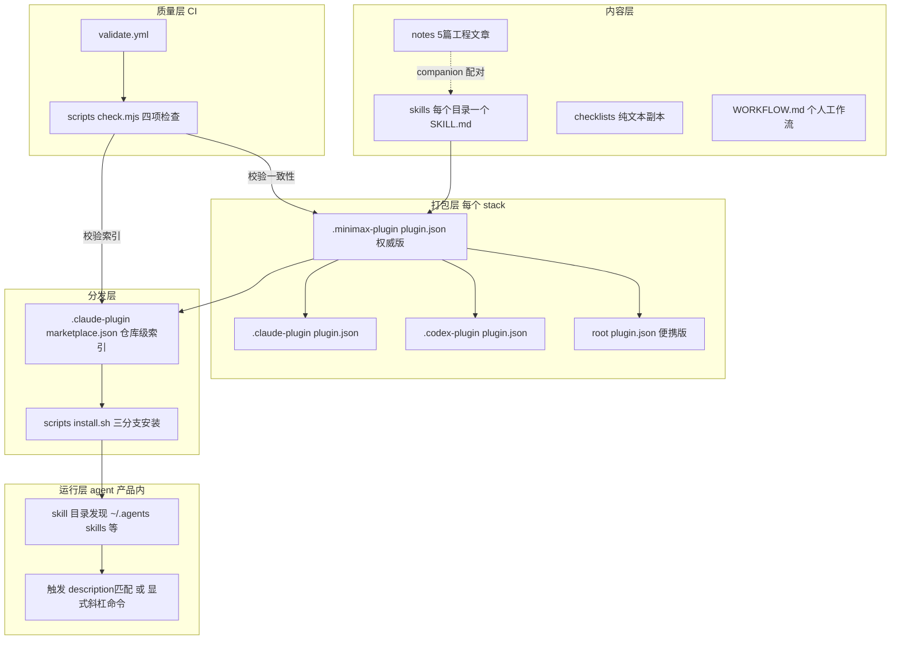
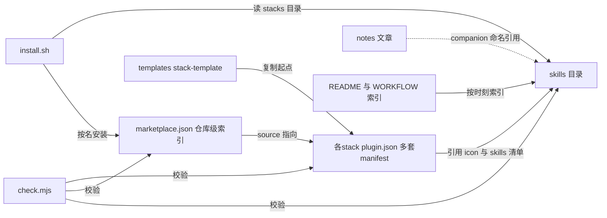
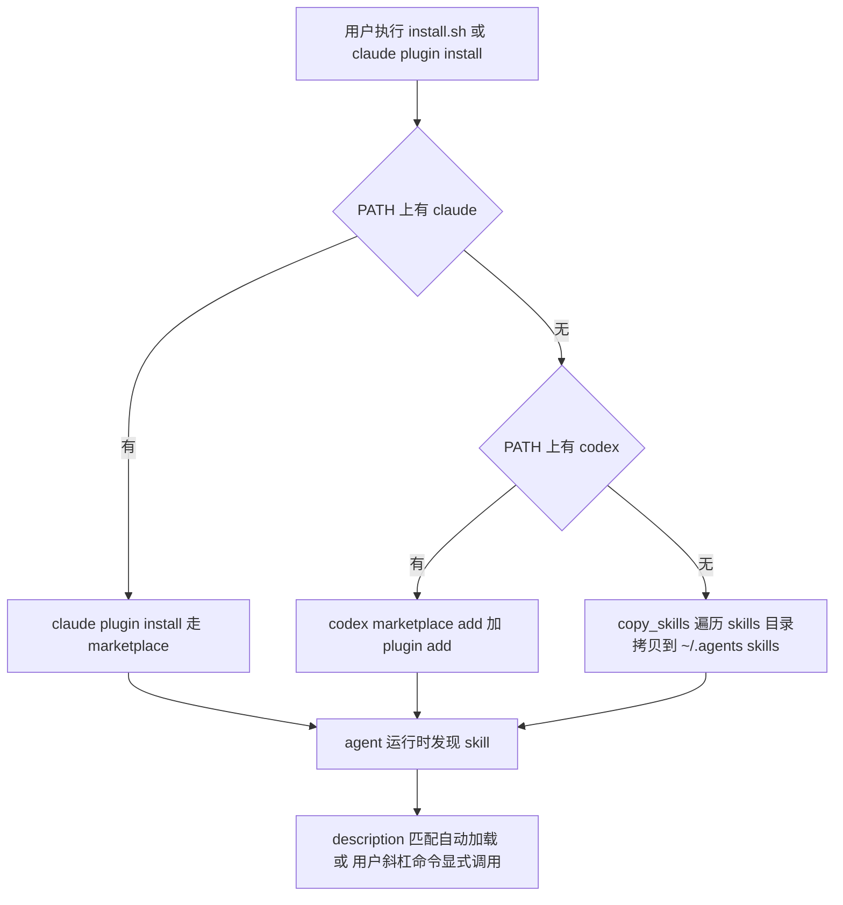

# 架构地图：mcode-stack

> 仓库：https://github.com/MiniMax-AI/mcode-stack | 分支：main | 提交：88f84be7075106d8ce283e5d3a8138cdb8f9a205 | 分析日期：2026-11-10

## 总体架构

本仓库无运行时代码，"架构"是**内容组织 + 打包 + 分发 + 质量保障**四层流水线。产品是一个 markdown 合集，所以执行路径就是「内容如何变成已安装的 skill」。



### 四层说明

| 层 | 职责 | 关键事实 |
| --- | --- | --- |
| 内容层 | skills（可触发能力）/ checklists（skill 的纯文本副本，供人直接读）/ WORKFLOW.md（何时用哪个 skill 的索引表）/ notes（思想文章） | ronny stack 19 skills；每篇文章配 companion skills（README Articles 表） |
| 打包层 | 每个 stack 打成三种 agent 的插件包。`.minimax-plugin/plugin.json` 是权威版，另三份（.claude-plugin / .codex-plugin / 根目录便携版）必须与之保持 name/version/description/author 一致 | 一致性**由 CI 强制**而非人工（check.mjs 头注释第 1 条） |
| 分发层 | 根 `.claude-plugin/marketplace.json` 把仓库注册为插件市场（每个 stack 一个条目，source 指向 `./stacks/<name>`）；install.sh 提供无 CLI 的降级路径 | marketplace.json 禁止 component 字段——skill 清单由 stack 自己的 plugin.json 定义（check.mjs 第 2 项） |
| 运行层 | agent 扫描 `~/.agents/skills/`（及 `.minimax/skills/`、`.claude/skills/` 等项目级目录）发现 skill，按 description 触发或显式调用 | 属于 agent 产品行为，仓库内静态分析不可见（见动态行为说明） |
| 质量层 | check.mjs 四项：仓库 lint（frontmatter/name/引用存在性）、marketplace 一致性、版本 bump 强制、官方 validator（可选） | validate.yml 在每个 PR 上跑 |

## 模块依赖关系



依赖方向：marketplace.json → 各 stack manifest → skills 目录。check.mjs 与 install.sh 都只消费这些声明式文件，互不依赖。

## 核心执行流程：一条命令的安装路径

文字调用链（每跳附源码位置）：

```text
claude plugin install ronny --marketplace MiniMax-AI/mcode-stack
  -> Claude Code 读 .claude-plugin/marketplace.json           [仓库根]
  -> marketplace.json plugins[] 中 name=ronny 的 source="./stacks/ronny"
  -> stacks/ronny/.minimax-plugin/plugin.json（schemaVersion 1，version 0.3.1）
  -> 按 manifest 安装 skills/ 下的 19 个 skill 目录
  -> 运行时 ~/.agents/skills/ 或产品内 plugin 目录被发现
```

无 CLI 的降级路径（VERIFIED，scripts/install.sh）：

```text
scripts/install.sh [stack=ronny]
  -> 校验 stack 名格式 ^[a-z][a-z0-9-]*$（L18-20）
  -> command -v claude 存在 -> claude plugin install（L60-63）
  -> 否则 command -v codex 存在 -> codex marketplace add + codex plugin add（L64-68）
  -> 都不存在 -> copy_skills(): 遍历 stacks/<stack>/skills/*/，
     要求每目录有 SKILL.md，rm -rf 旧目录后 cp -R 到 ~/.agents/skills/<name>（L33-53）
```

注意降级路径的边界（VERIFIED）：`copy_skills` 只拷 `skills/*/`，**checklists/ 与 WORKFLOW.md 不会进入 `~/.agents/skills/`**——纯拷贝模式下这两类内容只能从仓库直接读。



## 关键数据流：从文章到可运行件

```text
notes/01-subagent.md（思想）
  -> README Articles 表声明 companion: independent-review, subagent-split-check, harness-experiment
  -> stacks/ronny/skills/<name>/SKILL.md（可运行检查）
  -> 安装后 agent 按需加载，输出逐项检查结果
```

反向流：skill 的进化以文章为依据（notes 06→05 重命名见 git 历史），README 的 skills-map 按「一天中的时刻」而非技术分类组织——索引维度是用户的工作时刻，不是 skill 类型。

## 动态行为说明

| 行为 | 静态分析边界 | 依据 |
| --- | --- | --- |
| skill 何时被 agent 触发（description 语义匹配） | UNKNOWN——由各 agent 产品的运行时实现，仓库内容不可见 | 各 SKILL.md 的 description 是写给触发器的，但匹配算法在产品侧 |
| marketplace 的更新判断 | INFERRED——check.mjs 注释明确「Marketplace installs look at the version to decide whether an update is available」，但具体实现不在本仓库 | scripts/check.mjs 头注释第 3 条 |
| req-tpm 的 Feishu/Meegle 集成 | UNKNOWN——依赖外部 CLI（lark-cli/meegle），未安装无法验证 | stacks/req-tpm/README.md 声明 |

## 值得注意的设计（对本仓库最有借鉴价值的三个机制）

1. **版本 bump 强制检查**（VERIFIED，check.mjs 第 3 项）：`CHECK_BASE=origin/main` 时，凡自 merge base 以来文件有改动的 stack，plugin.json version 必须高于基线——否则 CI 失败。注释直言动机：「a change without a bump never reaches installed copies」。**用 CI 把「改了内容必须升版本」变成机械约束**，插件更新才能到达用户。用户自己的 skills 仓库（12 个 skill，手动维护版本）可直接借鉴。
2. **多 manifest 一致性靠 CI 不靠人**（VERIFIED）：四份 manifest 拷贝的一致性由 check.mjs 逐字段比对，杜绝「改了 minimax 版忘了 claude 版」。
3. **checklist 与 skill 双形态**（VERIFIED）：同一内容维护 SKILL.md（agent 走查）与 checklists/*.md（人直接读）两个副本——check.mjs 不校验两者内容同步（静态抽检未见比对逻辑），存在漂移风险，属 UNKNOWN。

## 证据清单

| 架构结论 | 证据 | 等级 |
| --- | --- | --- |
| 四层流水线结构 | README How it works 节 + 各层文件本体 | VERIFIED |
| install.sh 三分支降级 | scripts/install.sh L33-68 | VERIFIED |
| 降级路径不含 checklists/WORKFLOW | install.sh copy_skills 只遍历 skills/*/ | VERIFIED |
| manifest 一致性由 CI 强制 | scripts/check.mjs 头注释第 1 条 + 实现逐字段比对 | VERIFIED |
| 版本 bump 强制 | scripts/check.mjs 头注释第 3 条 | VERIFIED |
| marketplace 一 stack 一条目、无 component 字段 | .claude-plugin/marketplace.json + check.mjs 第 2 条 | VERIFIED |
| agent 运行时触发机制 | 不在仓库内 | UNKNOWN |
| marketplace 更新按版本判断 | check.mjs 注释声明，实现不在本仓库 | INFERRED |
| notes 与 skills 的配对关系 | README Articles 表 + notes/README.md | VERIFIED |
