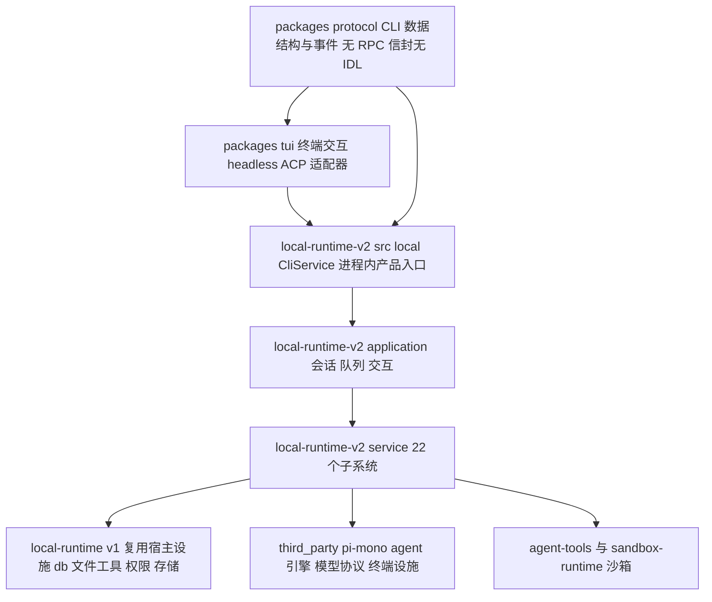
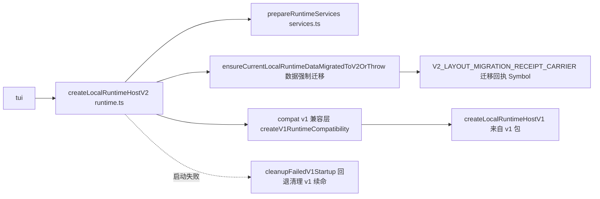

# 架构地图：minimax-code（重点：local-runtime-v2）

> 仓库：https://github.com/MiniMax-AI/minimax-code | 分支：main | 提交：3c21163c85a9684030cb147bfef48c6284fa3c46 | 分析日期：2026-11-10
> 本篇按用户指定重点覆盖 packages/local-runtime-v2；官方边界依据 docs/architecture.md（"Source boundaries"）。

## 总体架构：官方源边界链

官方一句话架构（docs/architecture.md L5，VERIFIED）：

```text
TUI / exec / ACP → CliService → local Applications → Session / Turn / Agent services → Pi / model providers / local tools
```



各层职责均有官方文字背书（VERIFIED）：

- **tui**：终端交互 + headless/ACP 适配器（docs/architecture.md L6）
- **local-runtime-v2/src/local**：进程内产品入口；会话查询视图与队列契约由本地服务类型派生（L7）
- **local-runtime-v2/src/application**：处理会话、队列、交互；**明确不实例化 DesktopService、HTTP front door、云交接服务**（L8）
- **local-runtime（v1）**：复用的宿主设施（数据库、文件工具、权限、存储）；历史读者只读旧会话文件，不代理 daemon、不回退 legacy 执行器（L9）
- **pi-mono**：agent 引擎、模型协议、终端基础设施；sandbox-runtime 保有沙箱 fork 与原生辅助（L10）

## 重点：local-runtime-v2

### 规模与分层（VERIFIED，实测）

全包 980 个 TS 文件、约 25.1 万行——**是全仓库最大的包**：

| 层 | 文件数 | 行数 | 职责 |
| --- | --- | --- | --- |
| service/ | 779 | 203,782 | 领域服务（22 个子系统，见下） |
| application/ | 89 | 21,754 | 会话/队列/交互的应用装配 |
| infra/ | 102 | 20,903 | 数据库（drizzle+SQLite）、日志、文件（canonical-history） |
| compat/ | 5 | 2,996 | v1 兼容层（runtime 兼容、失败清理） |
| local/ | 5 | 1,345 | CliService 入口 + host-contract |

对比：v1（packages/local-runtime）约 14.1 万行——v1+v2 合计约 39 万行本地运行时代码。

### service 层的 22 个子系统（VERIFIED，目录清单）

```text
agent  background-bash  browser-use  canvas  channel-system  content-safety
cron  host-connector-system  llm-context-inspector  mcp  miniapp  model-system
permission  pin  plan  plugin-system  prompt-config  sandbox  session-system
turn-system  v1-conversation-compat  workspace
```

其中 **turn-system** 最复杂，内部再分：agent-host（含 PTC 的 quickjs-worker）/ compaction / execution / lifecycle / persistence / queue.dispatcher / runaway-guard / steering-identity / admission-contracts。compaction 与 runaway-guard 与此前学习的 agent memory 文章（context-manager 协同）直接呼应。

### v1 → v2：教科书级绞杀者模式（Strangler Fig）

证据全部来自 src/runtime.ts 头部与 compat/（VERIFIED）：



| 绞杀要素 | 本仓库实现 | 证据 |
| --- | --- | --- |
| 新旧共存 | v2 工厂内部显式 import v1 工厂并保留兼容对象 | runtime.ts L9-10 `createLocalRuntimeHost as createLocalRuntimeHostV1` |
| 数据迁移 | 启动即强制迁移旧数据，迁移回执用 `Symbol.for` 挂载传递 | runtime.ts L49-51 |
| 失败回退 | v2 启动失败 → `cleanupFailedV1Startup` 清理后由 v1 续命 | runtime.ts import + compat/v1/runtime.ts |
| 历史兼容 | service/v1-conversation-compat + compat/ 目录（2,996 行） | 目录清单 |
| 存量读取 | 官方边界：历史读者只读旧会话文件，不代理不回退 | docs/architecture.md L9 |

### 意外发现：公开投影剥离 HTTP 层的配置残留（VERIFIED）

package.json 的 knip entry 与 jscpd ignore 都引用 `src/http/routing/bindings.gen.ts`、`src/http/generated/**`，但 **`find src -type d -name http` 为空——该目录不存在**。这与 docs/architecture.md「application 不实例化 HTTP front door」一致：内部单仓库曾有 HTTP 服务层，公开投影剥离了源码，工具配置里的引用未清理。结论：**本投影的 v2 是"无 HTTP 门面"形态，API 层以 CliService 进程内调用替代**；`src/http/**` 引用是投影剥离的化石证据。

### 技术栈要点（VERIFIED，package.json dependencies）

- 引擎：`@earendil-works/pi-ai / pi-agent-core / pi-coding-agent`（workspace 指向 third_party/pi-mono——即 pi 生态，与学习者日常使用的 pi 同源）
- 持久化：drizzle-orm + better-sqlite3；文件锁 proper-lockfile；定时 croner
- PTC（programmatic tool calling）沙箱：quickjs-emscripten（turn-system/agent-host/runner/ptc/quickjs-worker.ts，knip entry 佐证）
- 模板：handlebars；配置格式 smol-toml + yaml；HTTP 框架 hono 仍在依赖中（残留或内部使用，UNKNOWN）
- 工程纪律：knip（死代码）、jscpd（复制检测）、dependency-cruiser——三个工具全部配置在包内

## 核心执行流程：一次本地回合的链路（初步，待 Module 精读验证）

```text
用户输入 -> tui（终端交互）
  -> CliService（local-runtime-v2/src/local/app.ts createCliService）
  -> Application 层（conversation/queue/session application 装配投递）
  -> turn-system（admission -> queue.dispatcher -> agent-host/PiTurnRunner -> execution）
  -> pi-mono 引擎执行模型回合 + agent-tools 执行工具（沙箱经 sandbox-runtime）
  -> persistence（canonical-history / SQLite）-> 事件回流 tui 渲染
```

每一跳的文件级证据在 Module 精读时补齐；当前链路按目录命名与官方边界文档推导，标 **INFERRED**。

## 动态行为说明

- PiTurnRunner 对 pi 引擎的调用属运行时装配（agent-runtime 的 per-turn extension SPI + registry），静态分析只能到注册表边界，实际扩展生效集合运行时才确定（INFERRED）
- 插件（mcode-stack 安装物）经 plugin-system/plugin-hooks 注入回合，具体挂接点待精读
- 浅克隆（depth=50）导致 git 历史不可用于本包演化分析；v2 的演化只能从 compat/ 与迁移代码反推（INFERRED：v2 是近期重写，v1 设施仍在复用）

## 证据清单

| 架构结论 | 证据 | 等级 |
| --- | --- | --- |
| 官方源边界链 | docs/architecture.md L5 | VERIFIED |
| v2 分层与规模 | 目录实测（service 779 文件 20.4 万行等） | VERIFIED |
| 22 个 service 子系统 | src/service/ 目录清单 | VERIFIED |
| v1↔v2 绞杀关系 | runtime.ts imports + compat/ + 迁移 Symbol | VERIFIED |
| v1 供给宿主设施、不代理不回退 | docs/architecture.md L9 | VERIFIED |
| HTTP 层被投影剥离、配置有残留 | find 无 src/http + package.json knip/jscpd 引用存在 | VERIFIED |
| PTC 用 quickjs 沙箱 | package.json quickjs-emscripten + knip entry | VERIFIED |
| 回合执行链路逐跳 | 目录命名 + 边界文档推导 | INFERRED |
| hono 的实际使用位置 | 依赖存在但用途未定位 | UNKNOWN |
